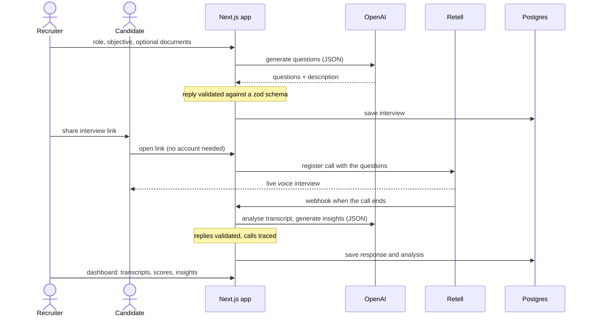

# AI Interviewer

[](https://github.com/mbessalle/ai-interviewer/actions/workflows/ci.yml)

[](LICENSE)

A voice interviewer for hiring. A recruiter describes a role, the app generates the interview questions, and
each candidate gets a link where an AI agent interviews them by voice, in English or Spanish. The recruiter
then sees the transcript, a communication analysis with supporting quotes, and insights across all candidates.

Live: [ai-interviewer-neon.vercel.app](https://ai-interviewer-neon.vercel.app) (sign-in required).

|                            |                                                                                                                 |
| -------------------------- | --------------------------------------------------------------------------------------------------------------- |
| **Full stack**             | Next.js 14 (App Router), TypeScript, Tailwind, shadcn/ui, Postgres with Drizzle, Clerk auth, deployed on Vercel |
| **Voice AI**               | Retell for the real-time voice call; OpenAI for question generation, analysis and insights                      |
| **Validated model output** | Every model reply is parsed against a zod schema before it is stored or shown                                   |
| **OpenTelemetry**          | Requests and model calls are traced, with model and token usage on each call                                    |
| **Access rules in code**   | The browser never talks to the database; every server action states who may call it, and tests prove it         |
| **Quality gates**          | Formatting, lint, strict type check, tests and a production build on every push                                 |

## How it works



## Model output is validated and traced

The three AI routes go through one helper, [`src/lib/llm/chat.ts`](src/lib/llm/chat.ts):

- **Validated.** Each prompt has a zod schema in [`src/lib/llm/schemas.ts`](src/lib/llm/schemas.ts): questions must be a
  non-empty list, a communication score must be between 0 and 10, a quote's type must be `strength` or
  `improvement_area`. A reply that does not fit is rejected with a `502` and the list of what was wrong, and is
  never written to the database.
- **Traced.** Each call is an OpenTelemetry span carrying the GenAI attributes (`gen_ai.request.model`,
  `gen_ai.usage.input_tokens`, `gen_ai.usage.output_tokens`), what the call was for, and whether the reply was
  valid. [`src/instrumentation.ts`](src/instrumentation.ts) turns tracing on at server start; on Vercel the traces appear in
  the project's observability view, and `OTEL_EXPORTER_OTLP_ENDPOINT` sends them to any OTLP collector.
- **Tested.** [`tests/llm.test.ts`](tests/llm.test.ts) runs the helper against a stand-in client: valid replies, four kinds of
  malformed reply, a provider failure, and the span attributes.

## The browser never talks to the database

Data access is three thin layers:

- **Queries** in [`src/db/queries/`](src/db/queries) are plain typed SQL through Drizzle, against the schema in
  [`src/db/schema.ts`](src/db/schema.ts). Only server code can import them.
- **Server actions** in `src/services/*.actions.ts` are what the browser calls. Each one states who may call it,
  using the Clerk session and never an id sent by the browser ([`src/lib/access.ts`](src/lib/access.ts)):
  - A recruiter reads and changes only interviews that belong to them or their organization.
  - A candidate, who has no account, can open an interview, start a response and mark their call as ended.
    They cannot set their own candidate status or plant analysis results.
  - "Has this email already answered?" returns yes or no, never the list of other candidates' emails.
- **Tests** run the real queries against a Postgres that lives inside the test process
  ([PGlite](https://pglite.dev)), built from the same migration files as production.
  [`tests/access.test.ts`](tests/access.test.ts) tries each action as a candidate, as a stranger from another
  organization and as the owner.

Any Postgres works. The deployed app uses a serverless Postgres that wakes on the first query; locally,
`docker compose up -d postgres` starts one.

## Run it

```bash
yarn install
cp .env.example .env.local   # Clerk, Retell and OpenAI keys
docker compose up -d postgres  # a local Postgres (or point DATABASE_URL at any Postgres)
yarn db:migrate              # create the tables
yarn dev                     # http://localhost:3000
```

```bash
yarn test        # no keys, network or database server needed
yarn typecheck
yarn lint
yarn build
```

## Layout

| Path                   | What it holds                                                                                  |
| ---------------------- | ---------------------------------------------------------------------------------------------- |
| `src/app/(client)/`    | Recruiter side: dashboard, interview pages, sign-in                                            |
| `src/app/(user)/call/` | Candidate side: the public voice-interview page                                                |
| `src/app/api/`         | Route handlers: question generation, call registration, the Retell webhook, analysis, insights |
| `src/lib/llm/`         | The validated, traced model-call helper and its schemas                                        |
| `src/lib/prompts/`     | Prompts, in English and Spanish                                                                |
| `src/db/`              | Drizzle schema, the connection and the SQL queries                                             |
| `src/services/`        | Server actions the browser calls, each with its access rule                                    |
| `drizzle/`             | SQL migrations, applied on every deploy by `scripts/migrate.mjs`                               |
| `tests/`               | Tests for the model-call helper, the queries and the access rules                              |

## Status

- Question generation and communication analysis were exercised on a deployed preview and returned valid,
  validated replies.
- The queries and access rules are tested against an in-process Postgres and were run once through the
  production driver against a Postgres 16 server.
- There are no end-to-end tests of the voice call.

## License

MIT
